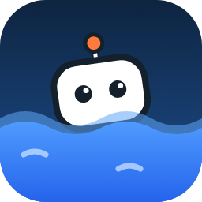
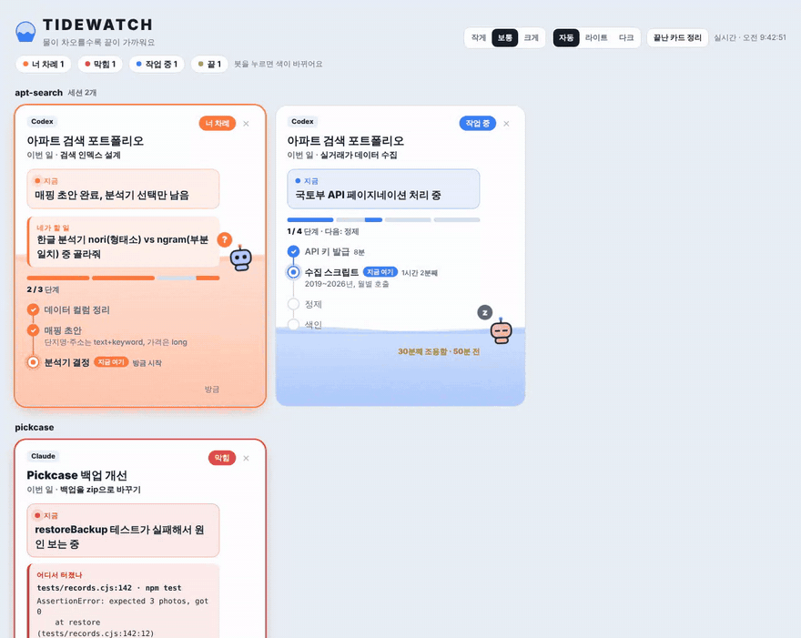
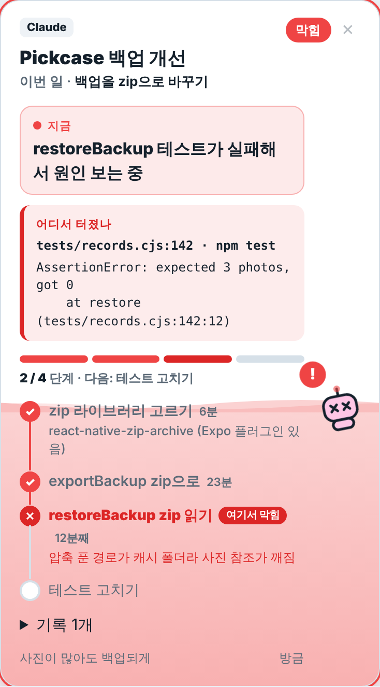
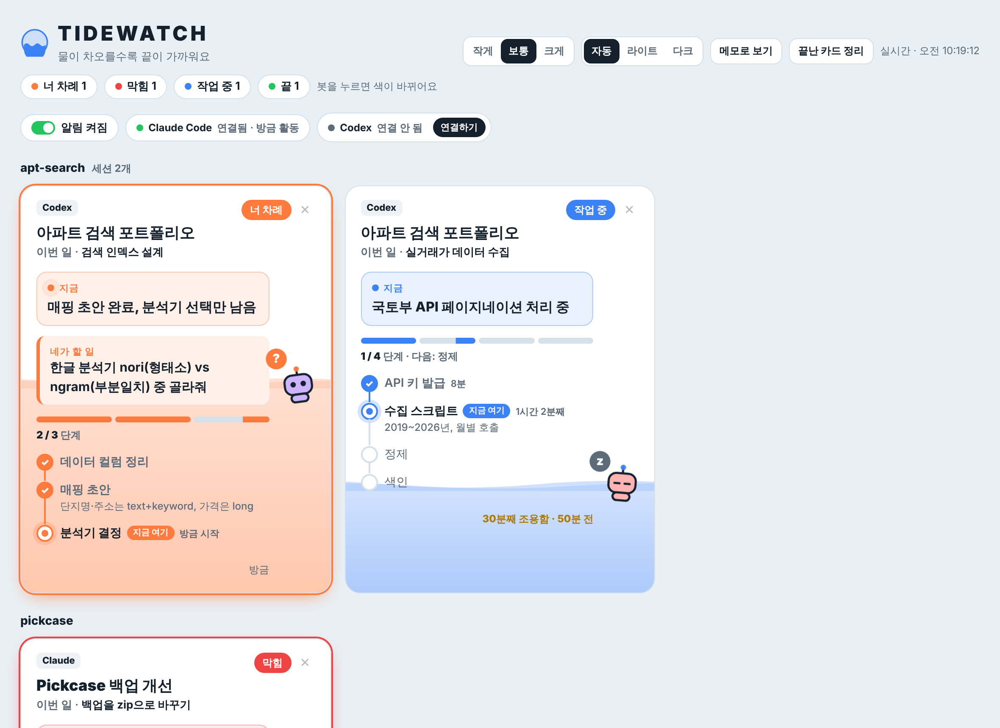
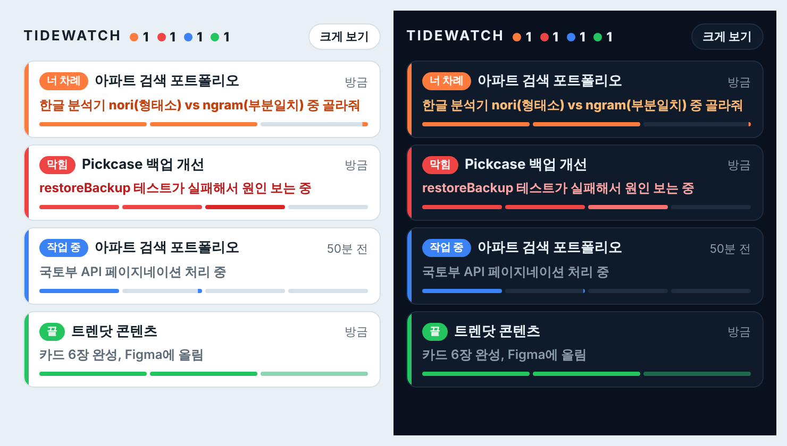

<div align="center">



# Tidewatch

**AI 코딩 세션 10개를 띄워놔도, 지금 누가 어디까지 했는지 한눈에.**

Claude Code와 Codex 세션의 진행 상황을 물이 차오르는 현황판으로 보여주는 에이전트 스킬



</div>

## 왜 만들었나

세션을 여러 개 띄워 놓고 일하다 보면, 다른 세션을 보다가 돌아왔을 때 *이 세션이 어디까지 했더라?* 하면서 터미널 로그를 한참 거슬러 올라가게 돼요. Tidewatch는 각 세션이 스스로 상태를 적어 두게 해서, 브라우저 창 하나만 보면 바로 알 수 있게 해 줘요.

- **지금 뭐 하는지**: 카드마다 "지금" 한 줄
- **어디까지 했는지**: 단계가 로드맵으로 보여요. 끝난 단계 ✓, 지금 단계 "지금 여기", 다음 단계까지. 진행만큼 물이 차오르고 단계마다 걸린 시간이 붙어요
- **무슨 주제인지**: 큰 제목은 세션의 대주제, 그 밑에 이번에 맡은 일
- **어디서 터졌는지**: 오류 난 단계는 빨간 ✕, 파일:줄과 에러 메시지가 "어디서 터졌나"에 떠요
- **내가 뭘 해야 하는지**: 세션이 나를 기다리면 "네가 할 일"과 함께 카드가 맨 위로 올라오고, 탭 제목에 `(2) Tidewatch`처럼 숫자가 떠요
- **세션 1개 = 카드 1장**: 같은 프로젝트의 세션은 프로젝트 이름 아래로 묶여요

<p align="center"></p>

## 현황판 창에서 바로 할 수 있는 것



- **펫·알림 스위치**와 **Claude Code·Codex 연결 상태** (스킬이 깔려 있는지, 마지막 활동이 언제인지). 연결 안 돼 있으면 **연결하기** 버튼
- 크기(작게·보통·크게)와 테마(자동·라이트·다크) 바꾸기. 설정은 기억돼요
- 봇을 누르면 색이 바뀌어요. 세션마다 처음부터 다른 색이에요
- 카드의 ✕, 또는 **끝난 카드 정리**로 지우기. 끝난 지 하루 지난 세션은 알아서 정리돼요

## 메모장 모드

큰 창이 부담스러우면 포스트잇 크기의 작은 창으로 볼 수 있어요. 세션마다 상태 배지, 대주제, "지금" 한 줄(내 차례면 "네가 할 일"), 얇은 진행 막대만 보여요.

<p align="center"></p>

- 앱 위쪽 **메모로 보기**, 펫 클릭, 또는 `node ~/.tidewatch/tidewatch.mjs mini`
- 줄을 누르거나 **크게 보기**를 누르면 큰 현황판이 열려요

## 펫 (Windows)

현황판 창을 띄워 두기 번거로우면, 작업표시줄 위를 걸어다니는 작은 봇이 전체 현황을 알려줘요. 설치하면 바로 뜨고, Tidewatch 앱 위쪽의 **펫** 스위치로 켜고 끌 수 있어요.

- 머리 위 말풍선: `너 차례 2 · Pickcase 백업 개선`처럼 제일 급한 것부터
- 움직임: 작업 중이면 걸어다니고, 너 차례면 제자리에서 통통, 막히면 덜덜, 다 끝나면 웃고, 조용하면 졸아요
- 마우스를 올리면 전체 세션 목록, 누르면 메모장 모드가 열려요
- 누른 채 끌면 원하는 곳으로 옮겨져요. 옮긴 자리는 기억하고, 오른쪽 클릭 → 작업표시줄로 돌아가기로 원래 자리로
- 오른쪽 클릭: 메모로 보기 · 현황판 크게 열기 · 알림 받기 · 가만히 있기 · Windows 시작할 때 켜기 · 작업표시줄로 돌아가기 · 펫 끄기

## 알림

세션이 **너 차례·막힘·끝**으로 바뀌는 순간 OS 알림이 한 번 와요 (Windows 토스트, macOS 알림 센터, Linux notify-send). 현황판 창을 닫아 둬도 와요.

- 끄기·켜기: 아무 세션에 "알림 꺼줘 / 켜줘", 또는 `node ~/.tidewatch/tidewatch.mjs notify off|on`
- 골라 받기: `node ~/.tidewatch/tidewatch.mjs notify only waiting,blocked`
- 현황판 위쪽에 🔔/🔕로 지금 상태가 보여요

## 봇 읽는 법

| 봇 | 상태 | 뜻 |
|---|---|---|
| 둥실둥실 | 🔵 작업 중 | 알아서 하는 중이에요 |
| `?` 띄우고 통통 | 🟠 너 차례 | 질문했거나 확인이 필요해요 |
| X 눈으로 덜덜 | 🔴 막힘 | 오류나 권한 때문에 멈췄어요 |
| `z` 졸음 | 🔵 + 노란 글씨 | 작업 중인데 30분째 소식이 없어요 |
| 웃음 | 🟢 끝 | 다 했어요 |

## 설치

[Node.js](https://nodejs.org)가 필요해요. Claude Code와 Codex에 한 번에 설치되고, 바탕화면에 **Tidewatch** 아이콘이 생겨요.

**Windows (PowerShell)**

```powershell
irm https://raw.githubusercontent.com/wonby1n/tidewatch/main/install.ps1 | iex
```

**macOS · Linux**

```sh
curl -fsSL https://raw.githubusercontent.com/wonby1n/tidewatch/main/install.sh | sh
```

**직접 설치**: [`tidewatch-skill.zip`](https://github.com/wonby1n/tidewatch/raw/main/dist/tidewatch-skill.zip)을 받아서 `tidewatch` 폴더를 아래 위치에 풀고, `tidewatch/scripts/tidewatch.mjs`를 `~/.tidewatch/tidewatch.mjs`로 복사하면 돼요.

| 에이전트 | 스킬 폴더 |
|---|---|
| Claude Code | `~/.claude/skills/tidewatch` |
| Codex | `~/.agents/skills/tidewatch` (예전 버전은 `~/.codex/skills/tidewatch`) |

## 쓰는 법

1. 바탕화면의 **Tidewatch**를 눌러 앱을 열어 둬요. 주소창 없는 좁은 창이라 화면 옆에 붙여 두기 좋아요. 앱은 내 컴퓨터 안에서만 도는 작은 서버(`127.0.0.1:47777`, 외부 접속 불가)로 열려서 펫·알림·연결 관리까지 할 수 있어요.
2. 각 세션에서 이렇게 말해요.
   - Claude Code: `타이드워치 켜줘` 또는 `/tidewatch`
   - Codex: `$tidewatch` 또는 `타이드워치 켜줘`
3. 그다음부터는 세션이 작업을 시작할 때, 단계를 끝낼 때, 오류가 났을 때, 그리고 턴을 끝내기 직전에 알아서 카드를 갱신해요.

여러 단계짜리 작업을 맡기면 말하지 않아도 스킬이 알아서 켜질 수 있어요.

### Codex 샌드박스

Codex의 기본 샌드박스는 작업 폴더 밖에 쓰는 걸 막아서, `~/.tidewatch`에 쓸 때 승인을 물어볼 수 있어요. 매번 묻지 않게 하려면 `~/.codex/config.toml`에 이렇게 추가하세요 (경로는 본인 홈 폴더로, 설정 이름은 Codex 버전에 따라 다를 수 있어요).

```toml
[sandbox_workspace_write]
writable_roots = ["C:\\Users\\me\\.tidewatch"]   # macOS·Linux: "/Users/me/.tidewatch"
```

## 언제 100%가 되나

진행률은 끝낸 단계의 비율이고, **끝(100%)**은 ① 모든 단계를 끝냈고 ② 테스트·빌드·실행처럼 결과를 직접 확인했고 ③ 내가 해야 할 일이 남지 않았을 때만 돼요. 마지막 단계가 내가 할 일(설치 실행, 실기기 확인 등)이면 "너 차례"로 기다리다가, 내가 "했어"라고 하면 끝으로 바뀌어요.

## 명령어

```sh
node ~/.tidewatch/tidewatch.mjs app      # 현황판을 앱 창으로 열기
node ~/.tidewatch/tidewatch.mjs mini     # 작은 메모 창으로 열기
node ~/.tidewatch/tidewatch.mjs pet      # 펫 켜기 (Windows)
node ~/.tidewatch/tidewatch.mjs open     # 기본 브라우저로 열기
node ~/.tidewatch/tidewatch.mjs build    # 현황판 다시 만들기
node ~/.tidewatch/tidewatch.mjs remove <id>
```

## 어떻게 동작하나

```
세션(Claude Code / Codex) ──쓰기──▶ ~/.tidewatch/sessions/<id>.json
                         ──실행──▶ tidewatch.mjs build ──▶ tidewatch.html + board-data.js
현황판 창 ◀──3초마다 board-data.js만 다시 읽기 (새로고침 없음)
```

- 서버도, 계정도, 네트워크도 필요 없어요. 모든 게 내 컴퓨터의 `~/.tidewatch` 폴더 안에만 있어요.
- 단계별 소요 시간은 `build`가 돌 때마다 단계 상태 변화를 `~/.tidewatch/.history`에 기록해서 계산해요.
- 세션 파일 형식은 [SKILL.md](skills/tidewatch/SKILL.md)에 있어요. 다른 에이전트나 스크립트도 같은 형식으로 쓰면 카드가 떠요.

<details>
<summary>세션 파일 예시</summary>

```json
{
  "agent": "claude",
  "project": "pickcase",
  "title": "Pickcase 백업 개선",
  "task": "백업을 zip으로 바꾸기",
  "status": "blocked",
  "now": "restoreBackup 테스트가 실패해서 원인 보는 중",
  "error": { "where": "tests/records.cjs:142 · npm test", "message": "AssertionError: expected 3 photos, got 0" },
  "steps": [
    { "text": "zip 라이브러리 고르기", "state": "done" },
    { "text": "restoreBackup zip 읽기", "state": "error", "detail": "압축 푼 경로가 캐시 폴더라 사진 참조가 깨짐" },
    { "text": "테스트 고치기", "state": "todo" }
  ]
}
```

</details>

## 개발

```sh
node test/smoke.mjs          # 예제 세션으로 보드를 만들고 동작 확인
```

`examples/`의 세션 파일로 현황판이 어떻게 보이는지 바로 볼 수 있어요.

## 라이선스

MIT
