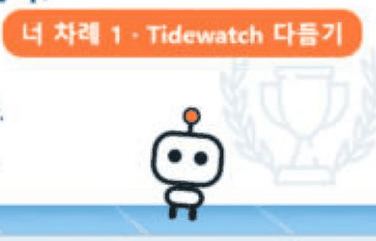

<div align="center">


# Tidewatch

**Run ten AI coding sessions at once and still see, at a glance, who is doing what.**

An agent skill for Claude Code and Codex that turns every session into a card on a live board.<br>
Each card fills with water as the work moves forward.

[English](README.md) · [한국어](README.ko.md)


</div>

> The board UI is in Korean for now. Labels are translated in the tables below; an English UI is on the roadmap.

## Desktop app (Windows)

Tidewatch now includes a standalone Electron desktop app. It opens its own window without launching Edge or Chrome. The board and compact view run inside the app; window size and position are remembered, and opening it again focuses the existing instance. The local backend stops when you close the last app window.

**[Download Tidewatch-Setup.exe](https://github.com/wonby1n/Tidewatch/releases/latest/download/Tidewatch-Setup.exe)** · [All releases and checksums](https://github.com/wonby1n/Tidewatch/releases/latest)

Run the installer, launch Tidewatch, connect your agent with **연결하기** (Connect), and start a new coding session with `/tidewatch` or `$tidewatch`. No source build is needed.

Before installing:
- Windows x64 only; ARM and 32-bit Windows have not been validated.
- The installer is unsigned, so Windows may show a warning. Verify the official source and SHA-256; do not disable security protections.
- Node.js is still needed for agent status updates. The installer does not install Node.js or the coding agents.
- No automatic updates. Uninstalling can leave local sessions, settings, and skills behind.

[Installation, privacy, limitations, checksums, and troubleshooting](docs/windows-install.md)

Build and install from source instead (Node.js and npm required):

```powershell
git clone https://github.com/wonby1n/Tidewatch.git
cd Tidewatch
npm ci
npm run package:win
powershell -NoProfile -File desktop/install.ps1
```

Open **Tidewatch** from your desktop. Existing session files in `~/.tidewatch` are preserved. The app uses web rendering internally and includes its own runtime; it does not use your installed browser. This build is unsigned. macOS and Linux desktop packaging has not been validated.

For development: `npm start`. For the isolated desktop smoke check, set `TIDEWATCH_DIR` to a temporary folder and run `npm run test:desktop`.

## Models and usage in the header

The top panel shows each agent's recent model, available 5-hour/weekly quota usage and reset times, and recent-session token counters. Codex uses its installed CLI's official account read API. Claude Code can forward its official status-line data with **사용량 연결** (Connect usage); an existing custom status line is preserved.

Unknown and stale values are labeled. Token counters are separate from subscription quotas. Use the manual limit flag when the provider has stopped responding; it is labeled as manually reported. Claude Desktop does not provide the Claude Code status-line integration.

[Data sources, setup, privacy, and limitations](docs/usage.md)

## Quick start

**Requires [Node.js](https://nodejs.org) for agent updates.** On Windows, use the standalone desktop app above. The lightweight installer below uses an installed browser in app mode; the skills CLI installs the skill only.

1. Choose an installation method below.
2. For the full install, open **Tidewatch** from your desktop.
3. Start a coding session and ask it to use Tidewatch: Claude Code `/tidewatch`; Codex `$tidewatch`. Include a concrete multi-step task so it has progress to report.
4. Look for a card with your task, current step, and anything it needs from you. If no card appears, check the skill installation and write access to `~/.tidewatch` (see Usage below).

**Preview without installing:** after downloading or cloning this repository, open [`docs/demo/index.html`](docs/demo/index.html) in your browser. It uses sample data; it does not connect agents, start a pet, or send notifications. Regenerate it with `node scripts/build-demo.mjs`.

**What the board measures:** agent-reported status and completed steps. It does not independently inspect every process or estimate time remaining. If an agent stops reporting, the previous status can remain; check the last update time.

## Lightweight install (browser app mode)

Requires [Node.js](https://nodejs.org). Installs the skill for both Claude Code and Codex, and adds a **Tidewatch** icon to your desktop.

**Windows (PowerShell)**

```powershell
irm https://raw.githubusercontent.com/wonby1n/tidewatch/main/install.ps1 | iex
```

**macOS · Linux**

```sh
curl -fsSL https://raw.githubusercontent.com/wonby1n/tidewatch/main/install.sh | sh
```

**With the skills CLI** (skill only, no desktop app or pet):

```sh
npx skills add wonby1n/Tidewatch
```

**Manual**: download [`tidewatch-skill.zip`](https://github.com/wonby1n/tidewatch/raw/main/dist/tidewatch-skill.zip), unzip the `tidewatch` folder into the skill folder below, and copy both `tidewatch/scripts/tidewatch.mjs` and `tidewatch/scripts/usage.mjs` into `~/.tidewatch/`.

| Agent | Skill folder |
|---|---|
| Claude Code | `~/.claude/skills/tidewatch` |
| Codex | `~/.agents/skills/tidewatch` (older versions: `~/.codex/skills/tidewatch`) |

## Usage

1. Open **Tidewatch** from your desktop and keep it open. The standalone desktop app has its own window; the lightweight installer uses an address-bar-free browser window. It runs through a tiny server that only listens on your own machine (`127.0.0.1:47777`), which is what lets the app switch the pet and notifications on and off.
2. In each session, say:
   - Claude Code: "turn on tidewatch" or `/tidewatch`
   - Codex: `$tidewatch` or "turn on tidewatch"
3. From then on the session updates its card when it starts, finishes a step, hits an error, and right before it hands the turn back to you.

For multi-step work the skill can switch itself on without being asked.

### Codex sandbox

Codex's default sandbox blocks writes outside the workspace, so it may ask for approval when it writes to `~/.tidewatch`. To stop the prompts, add the folder to `~/.codex/config.toml` (use your own home path; the setting name may differ between Codex versions):

```toml
[sandbox_workspace_write]
writable_roots = ["C:\\Users\\me\\.tidewatch"]   # macOS / Linux: "/Users/me/.tidewatch"
```

## Why

When you run many agent sessions side by side, coming back to one usually means scrolling up through a wall of terminal output to remember *where was this one?* Tidewatch has each session write a short status card for itself, so one window tells you everything.

- **What it is doing right now**: one highlighted "now" line per card
- **How far it got**: steps shown as a roadmap: done ✓, "you are here", what comes next, and how long each step took. The water level rises with progress
- **What it is about**: a big title for the session's overall theme, with the current task underneath
- **Where it broke**: the failing step turns red, with the file:line and the error message in a "where it broke" box
- **What it needs from you**: when a session is waiting on you, its card jumps to the top with a "your turn" note, and the tab title shows a count like `(2) Tidewatch`
- **One session = one card**: sessions from the same project are grouped under the project name

<p align="center"></p>

## The app


- **Pet and notification switches**, plus **Claude Code / Codex connection status** (is the skill installed, when was the last activity). If an agent is not connected, press **connect** (연결하기)
- Card size (small / normal / large) and theme (auto / light / dark), remembered between visits
- Click a bot to change its color; every session starts with its own color
- Remove cards with ✕ or **clear finished** (끝난 카드 정리). Finished sessions are cleaned up automatically after a day

| Label on the board | Meaning |
|---|---|
| 너 차례 | your turn: the session is waiting for you |
| 막힘 | blocked: an error or a permission stopped it |
| 작업 중 | working |
| 끝 | done |
| 지금 / 결과 | now / result |
| 네가 할 일 | what you need to do |
| 어디서 터졌나 | where it broke |
| 이번 일 | current task |
| 지금 여기 / 여기서 막힘 | you are here / stuck here |

## Sticky-note view

If the full board feels like too much, open a small sticky-note window. Each session gets one row: status, theme, one "now" line (or "your turn" note), and a thin progress bar.

<p align="center"></p>

- **메모로 보기** in the app, click the pet, or `node ~/.tidewatch/tidewatch.mjs mini`
- Click a row or **크게 보기** to open the full board

## Pet (Windows)

A small bot walks along the top of your taskbar and tells you how things are going. It starts after installing and you can switch it on or off from the app.

<p align="center"></p>

- A speech bubble shows the most urgent thing first, e.g. `너 차례 2 · Pickcase backup` (your turn: 2)
- It walks while sessions are working, hops in place when it is your turn, shivers when something is blocked, smiles when everything is done, and dozes when things go quiet
- Hover for the full session list; click to open the sticky-note view
- Drag it anywhere; it remembers the spot. Right-click → back to the taskbar to reset
- Right-click menu: sticky-note view · full board · notifications · stay still · start with Windows · back to the taskbar · quit

## Notifications

You get one OS notification the moment a session becomes **your turn**, **blocked** or **done** (Windows toast, macOS Notification Center, Linux notify-send), even with the board closed.

- Toggle from the app, from the pet's menu, by telling any session "turn notifications off/on", or with `node ~/.tidewatch/tidewatch.mjs notify off|on`
- Pick which ones you want: `node ~/.tidewatch/tidewatch.mjs notify only waiting,blocked`

## Reading the bots

| Bot | Status | Meaning |
|---|---|---|
| Floating | 🔵 working | busy on its own |
| `?` and hopping | 🟠 your turn | asked you something or needs a check |
| X eyes, shivering | 🔴 blocked | stopped by an error or a permission |
| `z`, dozing | 🔵 with yellow text | working, but silent for 30+ minutes |
| Smiling | 🟢 done | finished |

## When is a card done?

Progress is the share of finished steps. A card is **done** only when ① every step is finished, ② the result was actually checked (tests, build, running it), and ③ nothing is left for you to do. If the last step is yours (run the installer, try it on a device), the card waits on "your turn" until you say you did it.

## Commands

```sh
node ~/.tidewatch/tidewatch.mjs app      # open the app window
node ~/.tidewatch/tidewatch.mjs mini     # open the sticky-note view
node ~/.tidewatch/tidewatch.mjs pet      # start the pet (Windows)
node ~/.tidewatch/tidewatch.mjs open     # open in your default browser
node ~/.tidewatch/tidewatch.mjs build    # rebuild the board
node ~/.tidewatch/tidewatch.mjs remove <id>
```

## How it works

```
session (Claude Code / Codex) ──writes──▶ ~/.tidewatch/sessions/<id>.json
                              ──runs────▶ tidewatch.mjs build ──▶ tidewatch.html + board-data.js
app window ◀── re-reads board-data.js every 3 s (no page reload)
```

- No account, no cloud. Everything stays in `~/.tidewatch` on your machine. The app's local server only accepts requests from `127.0.0.1`, checks the Host header, and requires a per-run token for every action.
- Step durations come from `build` recording each state change in `~/.tidewatch/.history`.
- The session file format is documented in [SKILL.md](skills/tidewatch/SKILL.md). Any agent or script that writes the same format shows up on the board.

<details>
<summary>Example session file</summary>

```json
{
  "agent": "claude",
  "project": "pickcase",
  "title": "Pickcase backup",
  "task": "Switch backups to zip",
  "status": "blocked",
  "now": "restoreBackup test fails, looking for the cause",
  "error": { "where": "tests/records.cjs:142 · npm test", "message": "AssertionError: expected 3 photos, got 0" },
  "steps": [
    { "text": "Pick a zip library", "state": "done" },
    { "text": "Read zip in restoreBackup", "state": "error", "detail": "unzipped into the cache folder, photo paths break" },
    { "text": "Fix the tests", "state": "todo" }
  ]
}
```

</details>

## Development

```sh
node test/smoke.mjs          # builds a board from the example sessions and checks it
```

The sessions in `examples/` show what the board looks like right away.

## License

MIT
